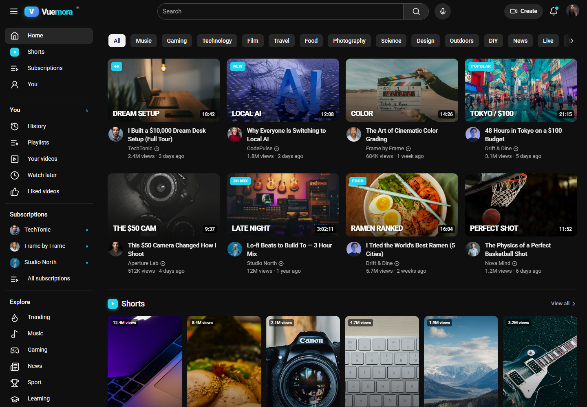
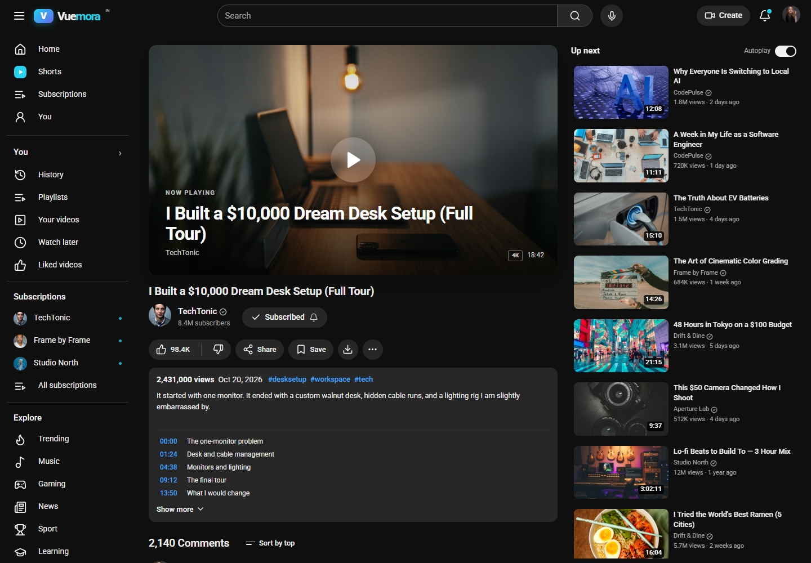
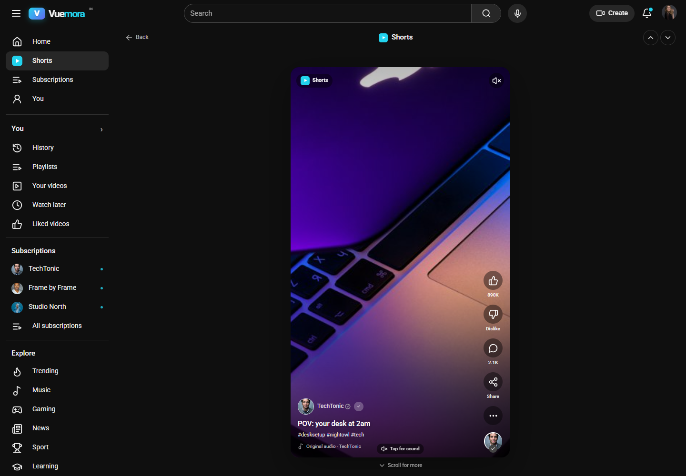
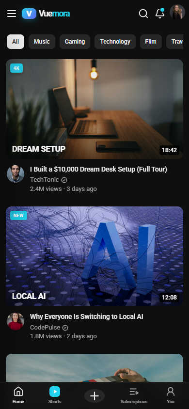

# Vuemora

A polished YouTube-inspired video platform built with React, TypeScript and Vite. It runs entirely in the browser with local sample media and persisted personal state — no backend or API keys required.



## Preview

| Watch | Shorts | Mobile |
| --- | --- | --- |
|  |  |  |

## Quick start

```bash
npm install
npm run dev
```

Open **http://127.0.0.1:4173**.

Production build:

```bash
npm run build
npm run preview
```

## What is included

- **Home feed** with category chips, responsive video grid, hover menus and a Shorts shelf that adapts to the current number of columns.
- **Watch experience** with a custom HTML5 player: play/pause, seeking, volume, playback speed, quality menu, captions, picture-in-picture, theater mode, fullscreen, keyboard shortcuts and an end screen.
- **Shorts** immersive vertical feed with scroll snapping, autoplay/pause on scroll, sound control, likes, comments drawer and keyboard navigation.
- **Search** with live suggestions, recent searches, channel and playlist results, filters and result rows.
- **Channels** with banner, avatar, subscribe state, Home/Videos/Shorts/Playlists/About tabs, sorting and an upload CTA on your own channel.
- **Subscriptions** feed with channel shortcuts and discovery cards for empty states.
- **You and Library**: history, watch later, liked videos, playlists and your own uploads.
- **Create** modal with upload/drop zone, thumbnail picker, live/post tabs and a working client-side publish flow.
- **Personalization**: dark/light themes, likes, dislikes, subscriptions, watch later and watch progress persisted in local storage.
- **Responsive design** for desktop, tablet and mobile, including a mobile drawer, bottom navigation and compact watch layout.
- **Notifications and account menus** with read state, appearance switch and keyboard shortcut hints.

## Keyboard shortcuts

| Key | Action |
| --- | --- |
| `/` | Focus search |
| `K` / `Space` | Play or pause |
| `M` | Mute / unmute |
| `F` | Fullscreen |
| `←` / `→` | Seek 5 seconds |
| `↑` / `↓` | Volume (watch page) / move between Shorts |
| `Esc` | Close panels and modals |

## Project structure

```
src/
  components/     player, top bar, guide, video cards, create modal
  pages/          home, watch, search, channel, library, shorts, settings
  data.ts         channels, videos, shorts, comments and formatting helpers
  store.tsx       persisted app state and actions
  router.ts       small hash router and URL helpers
  styles/         theme, layout and responsive CSS
public/
  avatars/        channel and profile portraits
  thumbs/         video thumbnails
  videos/         sample MP4 clips
  fonts/          local Roboto variable font
```

## Ownership and launch

- [OWNERSHIP.md](OWNERSHIP.md) — what is (and is not) transferred, plus the copyright, server and domain checklist.
- [CREDITS.md](CREDITS.md) — every third-party dependency and media source, with licenses.
- [LICENSE](LICENSE) — proprietary notice for **Chukka Siva**.
- [DEPLOYMENT.md](DEPLOYMENT.md) — Vercel, Netlify, Cloudflare Pages and Nginx instructions plus domain setup.
- [GITHUB_PAGES.md](GITHUB_PAGES.md) — publishing at `https://siva4915.github.io/` via the `gh-pages` branch.

**Owner:** Chukka Siva · **Working product name:** Vuemora

> I cannot legally transfer copyright or create hosting/domain accounts for you. Those must be established in the owner’s name. The documents above are a practical starting point, not legal advice. “Vuemora” is a working name: the `.com`, `.in`, `.tv` and `.app` domains appeared unregistered during initial screening, but it still needs a formal trademark search before launch.

## Demo notes

This is a front-end product study, not a production streaming service. Video views, subscriber counts and comments are seeded demo data. Uploaded files and newly published videos live for the current browser session only. Playback clips are generic sample footage rather than content matching each thumbnail.

Media credits: thumbnails and avatars from [Unsplash](https://unsplash.com); sample clips from [W3C media](https://media.w3.org), [Samplelib](https://samplelib.com) and [Pexels](https://www.pexels.com). Vuemora is not affiliated with YouTube. See [CREDITS.md](CREDITS.md) for the full asset and dependency audit.
